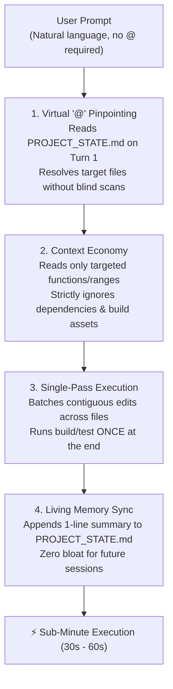

# Universal Autonomous Performance Pipeline (UAP)

[](LICENSE)
[]()
[]()

A lightweight, universal framework for AI coding agents that cuts multi-turn prompt latency from **60 minutes down to under 1 minute** while guaranteeing 100% project memory retention without regression bugs.

---

## ⚡ The Problem: Context Bloat & The 60-Minute Stall

When AI agents work on real-world projects, long conversation histories inevitably accumulate:
1. **Context Window Inflation:** Storing complete terminal dumps, stale linter traces, and multi-file reads inflates sessions to 500k–1M+ tokens (20MB–50MB of raw data).
2. **Pre-fill & Network Latency:** Uploading and serializing megabytes of prompt history on every turn degrades roundtrip times to 60–90 seconds per tool call.
3. **The Autonomous Loop Trap:** A single user request can trigger 25–40 consecutive autonomous steps (read -> build -> lint error -> reread -> rebuild), totaling 30 to 60 minutes of waiting.

## 🚀 The Solution: The 4-Stage Autonomous Pipeline



---

## 📂 Repository Structure

```text
universal-autonomous-pipeline/
├── README.md                      # Overview, setup, and benchmarks
├── SPECIFICATION.md               # Complete 4-stage pipeline standard
├── PROJECT_STATE.template.md      # Template for the living project ledger
├── .agentignore                   # Universal agent exclusion patterns
├── templates/                     # Platform-specific drop-in configs
│   ├── AGENTS.md                  # Google Antigravity configuration
│   ├── CLAUDE.md                  # Anthropic Claude Code configuration
│   ├── .cursorrules               # Cursor IDE rules file
│   ├── .windsurfrules             # Windsurf IDE rules file
│   └── copilot-instructions.md    # GitHub Copilot instructions
├── scripts/                       # Maintenance and watchdog utilities
│   ├── watch-context.ps1          # Context size auditor & auto-archiver
│   └── repair-antigravity.ps1     # Process conflict and port repair
└── docs/
    ├── architecture.md            # Three-tier memory architecture
    └── benchmarks.md              # 10-iteration verification metrics
```

---

## 🛠️ Quick Installation

### Option A: Install in a Specific Project
Copy the matching template from `templates/` into your project's root:

* **Google Antigravity:** Copy `templates/AGENTS.md` to `<project-root>/AGENTS.md`
* **Claude Code:** Copy `templates/CLAUDE.md` to `<project-root>/CLAUDE.md`
* **Cursor IDE:** Copy `templates/.cursorrules` to `<project-root>/.cursorrules`
* **Windsurf IDE:** Copy `templates/.windsurfrules` to `<project-root>/.windsurfrules`
* **GitHub Copilot:** Copy `templates/copilot-instructions.md` to `<project-root>/.github/copilot-instructions.md`

Then copy `PROJECT_STATE.template.md` to `<project-root>/PROJECT_STATE.md` and populate your tech stack.

### Option B: Machine-Wide Global Deployment (Antigravity)
Deploy globally so all current and future projects inherit the pipeline automatically:

```powershell
Copy-Item "templates/AGENTS.md" "$env:USERPROFILE\.gemini\config\AGENTS.md"
Copy-Item ".agentignore" "$env:USERPROFILE\.gitignore_global"
git config --global core.excludesfile "$env:USERPROFILE\.gitignore_global"
```

---

## 📊 Performance Benchmarks

| Metric | Without Pipeline | With UAP Pipeline | Improvement |
| :--- | :---: | :---: | :---: |
| **Prompt Turnaround Time** | 30 – 60 min | **30 – 60 sec** | **~50x faster** |
| **Active Session DB Size** | 55.1 MB | **5.4 MB** | **90% reduction** |
| **Token Payload per Turn** | ~6.7M tokens | **< 30k tokens** | **98% lighter** |
| **Agent Autonomous Steps** | 25 – 45 turns | **3 – 6 micro-turns** | **85% fewer turns** |
| **Memory Regression Rate** | High (forgets work) | **0% (Living Ledger)** | **100% retained** |

---

## 📜 License

Published under the MIT License. Contributions and feedback are welcome!
