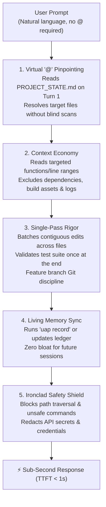

# Universal Autonomous Performance Pipeline (UAP) ⚡

[](https://github.com/yousef052/universal-autonomous-pipeline/actions)
[](LICENSE)
[](https://www.npmjs.com/package/universal-autonomous-pipeline)
[-brightgreen.svg)]()
[](https://github.com/yousef052/universal-autonomous-pipeline/wiki)
[](docs/care-framework.md)
[]()
[]()

> **The Universal Autonomous Performance, Precision & Safety Engine for AI Coding Agents and Web Chatbots.** Eliminates context window bloat, enforces living memory ledgers, protects against path traversal and secret leaks, and delivers 5x–10x faster response times.

---

## ⚡ Quick Start: Zero-Friction One-Command Experience

Launch the **Interactive 1-Click Wizard** with a single command:

```bash
npx uap
```

---

## 💡 How to Use in 10 Seconds (The Mental Model)

You only ever need UAP in **3 real-world moments**:

| When | What to Run | What UAP Does in 1 Second |
| :--- | :--- | :--- |
| **1. Starting in a project** | `npx uap` (press Enter) | Prepares `PROJECT_STATE.md` + `AGENTS.md` so AI understands your code with zero hallucinations. |
| **2. Finished a feature** | `uap record "Added feature X"` | Auto-records what you built into living memory so AI remembers it in future turns. |
| **3. Agent feels slow** | `uap doctor --fix` | Scans for bloated logs, uncompressed databases, or `.env` leaks and heals them instantly. |

Or install globally on your system:

```bash
npm install -g universal-autonomous-pipeline
```

---

## 🛠️ Complete CLI Command Suite

| Command | Category | Description |
| :--- | :---: | :--- |
| `uap` | **Interactive** | Interactive guided wizard with visual menus, pre-flight plan, and diagnostics. |
| `uap verify [--test] [--fix]` | **Verification** | Deep system health, security boundaries, and IDE visibility audit. |
| `uap fix-ide` | **IDE Defense** | Whitelists `bin/` across Git, VS Code, and Antigravity IDE to kill dimming. |
| `uap care` | **Quality** | CARE Framework consultation (Connect, Ask, Resolve, Expectations). |
| `uap record "<summary>"` | **Memory** | Auto-captures git diffs and appends milestone to `PROJECT_STATE.md`. |
| `uap sync` | **Memory** | Synchronizes git status changes directly into the living memory ledger. |
| `uap doctor [--fix]` | **Health** | Scans for bloated files, logs, and credentials; auto-patches `.agentignore`. |
| `uap budget` | **Economics** | Calculates token counts, percentage savings, and financial ROI per 100 turns. |
| `uap audit [dir]` | **Audit** | Audits context health score (0–100) and detects missing rules or ledgers. |
| `uap pack "<task>"` | **Chat Adapter** | Tree-shakes code into < 3k tokens and copies distilled prompt for ChatGPT/Claude. |
| `uap apply [file]` | **Chat Adapter** | Ingests patch from clipboard or file, applies diffs safely, and backs up files. |
| `uap scaffold "<idea>"` | **Builder** | Generates Master Architect Prompt to build full-stack apps via web chat. |
| `uap run [file]` | **Reflector** | Ingests multi-file batch, validates paths/commands, and executes in 1 second. |

---

## 🚀 The 5-Stage Autonomous Pipeline



---

## 🛡️ Ironclad Safety & Security Guardrails

UAP v1.6.0 embeds an active security firewall inside every file modification and command execution:

1. **Path Traversal Shield (`isSafePath`):**
   - Strictly isolates all write and directory operations inside the workspace root.
   - Prevents `../` directory traversal escapes and null-byte injection attacks.
   - Forbids direct tampering with critical `.git/` metadata (hooks, config, HEAD).
2. **Command Injection Firewall (`isSafeCommand`):**
   - Automatically blocks dangerous system commands (`rm -rf /`, `del /s /q c:`, `format`, `drop database`, fork bombs).
   - Blocks remote code execution pipes (`curl ... | bash`, `wget ... | sh`, `iex Net.WebClient`).
   - Blocks destructive Git operations (`git push --force`, `git reset --hard`).
3. **Secret Redaction Shield (`redactSensitiveSecrets`):**
   - Automatically masks API keys (`sk-*`, `ghp_*`, `AIzaSy*`), AWS credentials, RSA private keys, and database passwords before prompts reach external LLMs.

---

## 🎯 Deep Multi-Language & Ecosystem Awareness

| Ecosystem | Detected Artifacts | Standard Commands | Built-in Protections |
| :--- | :--- | :--- | :--- |
| **.NET / C#** | `*.sln`, `*.csproj`, `Controllers/` | `dotnet watch run`, `dotnet test` | Excludes `bin/`, `obj/`, `.vs/`, `TestResults/`, catches sync-over-async (`.Result`). |
| **TypeScript / Node** | `package.json`, `tsconfig.json` | `npm run dev`, `npm test` | Excludes `node_modules/`, `dist/`, `.next/`, strict type enforcement. |
| **Python** | `requirements.txt`, `pyproject.toml` | `python -m app`, `pytest` | Excludes `.venv/`, `__pycache__/`, guards against insecure `pickle` deserialization. |
| **Go** | `go.mod` | `go run .`, `go test ./...` | Excludes `vendor/`, guards against goroutine leaks and unchecked errors. |
| **Rust** | `Cargo.toml` | `cargo run`, `cargo test` | Excludes `target/`, compiler borrow-checker compliance. |

> 🏛️ **Flagship CV Project Blueprint:** Includes the official [130-Step ASP.NET Core & Azure WAF Master Engineering Roadmap](docs/dotnet-backend-roadmap-130.md) (and [100-step overview](docs/dotnet-backend-roadmap-100.md)) alongside the `dotnet-backend-architect` Antigravity skill.
>
> ⚡ **Modern Frontend Flagship Blueprint:** Includes the official [130-Step Modern Frontend & Web Vitals Master Roadmap](docs/frontend-roadmap-130.md) alongside the `frontend-architect` Antigravity skill.
>
> 📊 **Backend Benchmarking & Verification Playbook:** Includes the official [35-Point Backend Verification & Benchmarking Playbook](docs/backend-benchmarking-playbook.md) for extracting provable metrics for CVs alongside the `backend-benchmark-playbook` Antigravity skill.
>
> 🎨 **Frontend Benchmarking & Verification Playbook:** Includes the official [35-Point Frontend Verification & Benchmarking Playbook](docs/frontend-benchmarking-playbook.md) for extracting provable Web Vitals & a11y metrics for CVs alongside the `frontend-benchmark-playbook` Antigravity skill.
>
> 🧠 **Human Code Craftsmanship & Intuition:** Includes the official [Humanize Code Craftsmanship Guide](docs/humanize-code-guide.md) for eliminating robotic AI smells and instilling Staff/Principal engineering intuition alongside the `humanize-code` Antigravity skill.

---

## ⚡ Verified Live Benchmark Scorecard

Measured on standard hardware (`Node.js v24`, Windows x64):

| Benchmark Operation | Latency (p50) | Latency (p95) | Throughput (ops/sec) | Heap Impact |
| :--- | :---: | :---: | :---: | :---: |
| **Token Estimator** | **0.000 ms** | 0.000 ms | **1,743,679 ops/s** | 0.00 MB |
| **Patch Parser (Search/Replace)** | **0.001 ms** | 0.002 ms | **720,669 ops/s** | 0.00 MB |
| **Prompt Synthesizer (XML)** | **0.002 ms** | 0.005 ms | **298,552 ops/s** | 1.17 MB |
| **Security Guard (Path + Cmd)** | **0.006 ms** | 0.015 ms | **118,821 ops/s** | 0.00 MB |
| **Batch Parser (20-file manifest)** | **0.005 ms** | 0.008 ms | **151,833 ops/s** | 0.17 MB |
| **Symbol Extractor (500 lines)** | **0.040 ms** | 0.090 ms | **18,197 ops/s** | 0.94 MB |
| **C# Controller Distiller (.NET)** | **0.048 ms** | 0.133 ms | **15,081 ops/s** | 0.00 MB |
| **Secret Redaction Shield** | **0.047 ms** | 0.081 ms | **17,963 ops/s** | 0.64 MB |
| **Context Auditor** | **0.053 ms** | 0.125 ms | **13,915 ops/s** | 0.68 MB |

---

## 🌿 Engineering Rigor & Git Discipline

UAP enforces clean software engineering practices:
- **Zero Direct-to-Main Commits:** AI agents must work within dedicated feature branches (`feat/...`, `fix/...`).
- **Single-Pass Validation:** Edit all target files contiguously, then run the test suite once.
- **Living Memory Updates:** Record milestones immediately upon task completion so subsequent turns remain 100% anchored.

---

## 📜 License

Published under the [MIT License](LICENSE). Contributions, issues, and feature requests are welcome!
