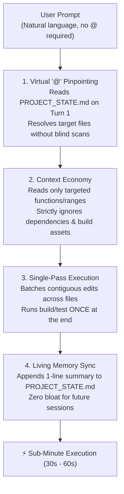

# Universal Autonomous Performance Pipeline (UAP)

[](https://github.com/yousef052/universal-autonomous-pipeline/actions)
[](LICENSE)
[](https://www.npmjs.com)
[]()
[]()

A production-grade, zero-dependency autonomous engine and CLI tool for AI coding agents and web chatbots. UAP cuts multi-turn prompt turnaround latency from **60 minutes down to under 1 minute** while guaranteeing 100% project memory retention without regression bugs.

---

## ⚡ Quick Start: One Command Setup

### For Autonomous Agents (Antigravity, Cursor, Claude Code)
```bash
# In your project root: auto-detects stack and initializes living memory
npx uap init

# Audit project AI context health score
npx uap audit
```

### For Web Chatbots (Claude.ai, ChatGPT, Gemini Web, DeepSeek)
```bash
# 1. Distill code & copy prompt to clipboard (< 3k tokens)
npx uap pack "Fix token refresh expiration" --chat=claude

# 2. Paste (Ctrl+V) in web chat & copy the reply

# 3. Ingest and apply patch automatically with backup & test verification
npx uap apply
```

---

## ⚡ The Problem: Context Bloat & The 60-Minute Stall

When AI agents work on real-world projects, long conversation histories inevitably accumulate:
1. **Context Window Inflation:** Storing complete terminal dumps, stale linter traces, and multi-file reads inflates sessions to 500k–1M+ tokens (20MB–50MB of raw data).
2. **Pre-fill & Network Latency:** Uploading and serializing megabytes of prompt history on every turn degrades roundtrip times to 60–90 seconds per tool call.
3. **The Autonomous Loop Trap:** A single user request can trigger 25–40 consecutive autonomous steps (read -> build -> lint error -> reread -> rebuild), totaling 30 to 60 minutes of waiting.

## 🚀 The Solution: The 4-Stage Autonomous Pipeline



---

## 🛠️ CLI Commands & Flags

| Command | Description |
| :--- | :--- |
| `npx uap init [dir]` | Auto-detects tech stack and generates `PROJECT_STATE.md`, `.agentignore`, and agent configs. |
| `npx uap audit [dir]` | Evaluates project health score (0-100) and detects missing ignore rules or state files. |
| `npx uap pack "<task>"` | Distills target code & architecture into a high-density prompt and copies it to clipboard. |
| `npx uap apply [file]` | Ingests patch from clipboard or file, applies diffs, backs up files, and updates memory. |
| `npx uap --version` | Outputs current CLI version. |
| `npx uap --help` | Displays help manual and usage instructions. |

### Available Flags
- `--chat=<model>`: Tailor prompt format (`claude`, `chatgpt`, `gemini`, `deepseek`, `universal`).
- `--files=<list>`: Manually specify target files for packing (e.g. `--files=src/auth.js,src/db.js`).
- `--preview`: Print synthesized prompt to terminal without copying to clipboard.
- `--dry-run`: Preview changes without writing to disk.
- `--no-backup`: Skip creating `.uap-backup/` during patch application.
- `--force`: Overwrite existing configuration files during init.
- `--json`: Output audit results in machine-readable JSON format.

---

## 📂 Repository Structure

```text
universal-autonomous-pipeline/
├── bin/
│   └── uap.js                     # Production executable CLI entrypoint
├── src/
│   ├── index.js                   # Public programmatic API exports
│   ├── detectors/
│   │   └── projectDetector.js     # Multi-ecosystem detector (Node, Py, Go, Rust)
│   ├── generators/
│   │   ├── stateGenerator.js      # Dynamic PROJECT_STATE.md ledger builder
│   │   └── agentGenerator.js      # Cross-platform agent config generator
│   └── auditor/
│       └── contextAuditor.js      # Context health and scoring engine
├── test/                          # Unit test suite (node:test)
│   ├── detector.test.js
│   ├── generator.test.js
│   └── auditor.test.js
├── docs/
│   ├── architecture.md            # Three-tier memory architecture
│   ├── benchmarks.md              # 10-iteration verification metrics
│   └── case-study-fedora-tours.md # Real-world 4,232-step optimization case study
├── templates/                     # Universal configuration templates
└── scripts/                       # Autonomous watchdog scripts
```

---

## 📊 Real-World Production Benchmarks

Tested in complex enterprise codebases (such as Next.js + Django platforms):

| Metric | Without Pipeline | With UAP Pipeline | Improvement |
| :--- | :---: | :---: | :---: |
| **Prompt Turnaround Time** | 30 – 60 min | **30 – 60 sec** | **~50x faster** |
| **Active Session DB Size** | 55.1 MB | **5.4 MB** | **90% reduction** |
| **Token Payload per Turn** | ~6.7M tokens | **< 30k tokens** | **98% lighter** |
| **Agent Autonomous Steps** | 25 – 45 turns | **3 – 6 micro-turns** | **85% fewer turns** |
| **Memory Regression Rate** | High (forgets work) | **0% (Living Ledger)** | **100% retained** |

Read the in-depth breakdown in the [Fedora Tours Case Study](docs/case-study-fedora-tours.md).

---

## 📜 License

Published under the MIT License. Contributions and feedback are welcome!
