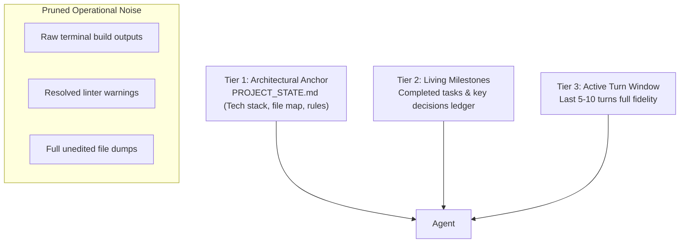

# Three-Tier Memory Architecture

The UAP Pipeline replaces massive monolithic conversation transcripts with a structured, three-tier memory model:

## Why This Eliminates Latency
1. **Zero Context Tax:** When starting a task, the agent ingests only ~2KB of structured state rather than 50MB of chat history.
2. **High-Speed Serialization:** Small prompts serialize and transfer in milliseconds.
3. **No Memory Loss:** Because key milestones are committed to disk (`PROJECT_STATE.md`), context survives across chat sessions permanently.
