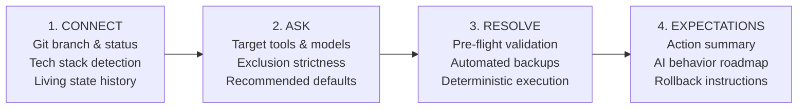

# The CARE Quality Framework in UAP

## Elevating AI Developer Tools through Rigorous Quality Standards

When software engineers interact with AI developer tools, they often experience anxiety:
- *"Will this tool overwrite my uncommitted work?"*
- *"Does the tool understand my tech stack and framework version?"*
- *"What should I expect after running this command?"*

To solve this, UAP implements the **CARE Quality Framework**:
- **C** - **Connect:** Establish deep repository context and empathetic connection.
- **A** - **Ask:** Intelligently clarify requirements before blind execution.
- **R** - **Resolve:** Deliver deterministic, zero-bloat, production-grade solutions.
- **E** - **Expectations:** Align post-execution expectations and provide verification/rollback roadmaps.

---

## The 4 Pillars of CARE



---

### 1. CONNECT (Context & Empathy)
Before proposing any actions, UAP establishes connection with:
- The active Git branch and clean/dirty working tree status.
- Primary programming languages, runtime frameworks, and package manifests.
- Historical milestones stored in `PROJECT_STATE.md`.
- Current context health score (0-100).

```text
┌──────────────────────────────────────────────────────────────────┐
│ 🤝 [CARE: CONNECT] Repository Context Established                │
├──────────────────────────────────────────────────────────────────┤
│ Project Name:    fedora-tours                                    │
│ Active Tech:     Next.js Application (React / TypeScript)        │
│ Git Environment: main (Clean)                                    │
│ Context Health:  Score: 100/100 (Grade: A)                       │
│ Living Ledger:   Initialized & Synchronized                      │
└──────────────────────────────────────────────────────────────────┘
```

---

### 2. ASK (Intelligent Clarification)
Instead of assuming or guessing, UAP probes with precision:
- Which AI coding agents do you primarily work with? (Antigravity, Cursor, Claude Code, Windsurf)
- What level of context exclusion is appropriate for your project?
- Which web chatbot destination is targeted? (Claude XML vs ChatGPT Diff vs Gemini Markdown)

---

### 3. RESOLVE (Deterministic Execution)
UAP resolves the problem with concrete guarantees:
- **Pre-flight Plan:** Displays exactly which files will be created or touched before asking for confirmation.
- **Automatic Backup:** Saves untouched copies in `.uap-backup/`.
- **Zero Telemetry:** 100% of execution is local on your machine.
- **Single-Pass Batches:** Edits and configurations happen in a single coordinated pass.

---

### 4. EXPECTATIONS (Alignment & Roadmaps)
Upon completion, UAP eliminates ambiguity:
- **What was changed:** Concrete summary of modified files.
- **What to expect now:** How your AI coding agent or chatbot will behave on the next turn.
- **How to verify:** Exact terminal verification commands (`npx uap audit` / `npm test`).
- **How to rollback:** Clear instructions on restoring files if needed.

---

## How to Run CARE Consultation

Launch interactive CARE mode in any project:
```bash
npx uap care
```
Or select `[C] CARE Smart Quality Consultation` from the interactive menu:
```bash
npx uap
```
