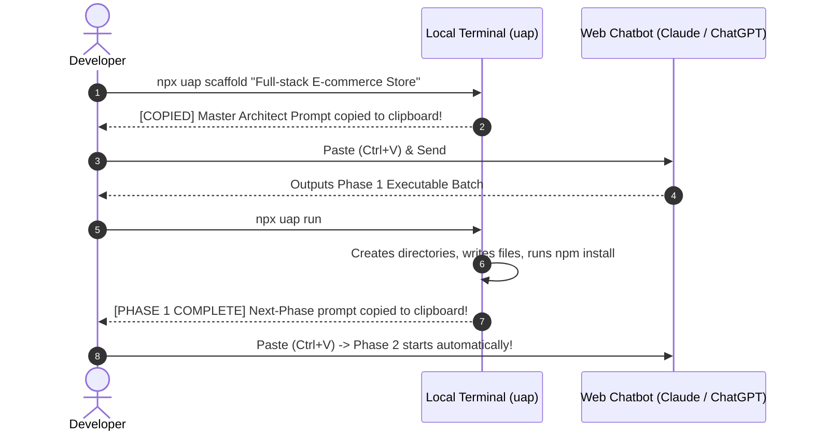

# Zero-Agent Project Building Guide

## Build Full-Stack Projects with Only a Web Browser & One-Click Terminal Reflector

If you don't have an AI coding agent installed and only have a web browser (ChatGPT, Claude.ai, Gemini, or DeepSeek), you can still build full-scale applications from scratch with zero manual copy-pasting.

---

## The 3-Step "Scaffold & Run" Workflow



---

## 1. Generate Master Architect Prompt

In your empty project directory, run:

```bash
npx uap scaffold "Full-Stack Task Management SaaS with Next.js 14, Tailwind, and Prisma"
```

You can customize the stack:
```bash
npx uap scaffold "FastAPI REST API with PostgreSQL & Docker" --stack="FastAPI, SQLAlchemy, Pydantic, Docker"
```

The CLI automatically copies the **Master Architect Prompt** to your clipboard.

---

## 2. Paste into Web Chatbot

Open [ChatGPT](https://chatgpt.com) or [Claude.ai](https://claude.ai) and paste (`Ctrl+V`).

The chatbot responds in **Autonomous Architect Mode**, outputting a self-contained batch for Phase 1:

```text
<<<UAP_BATCH_START>>>
PHASE: 1/4
MKDIR: src/components
MKDIR: src/lib
MKDIR: prisma

WRITE: package.json
{
  "name": "task-saas",
  "version": "0.1.0",
  "scripts": { ... }
}
<<<END_WRITE>>>

WRITE: prisma/schema.prisma
datasource db { ... }
<<<END_WRITE>>>

WRITE: PROJECT_STATE.md
# Project Architecture Ledger
...
<<<END_WRITE>>>

EXEC: npm install
EXEC: npx prisma generate

NEXT_PROMPT: Please proceed to Phase 2: Core Data Models and Database Repositories.
<<<UAP_BATCH_END>>>
```

---

## 3. Reflect to Terminal in One Click

Copy the chatbot's response (`Ctrl+C`), then run:

```bash
npx uap run
```

### What happens in 1 second:
1. All directories are created recursively.
2. All files are written to disk simultaneously with zero placeholders.
3. Safe shell commands (`npm install`, etc.) are executed automatically.
4. `PROJECT_STATE.md` milestone ledger is synchronized.
5. **The prompt for Phase 2 is automatically copied to your clipboard!**

---

## 4. Continue to Next Phases

Simply switch back to your browser, press `Ctrl+V`, and send!
Repeat `npx uap run` for:
- **Phase 2:** Core Business Logic & Repositories
- **Phase 3:** API Routes & Controllers
- **Phase 4:** UI Pages & Tests

Within 4 minutes, you have a complete, running application built from scratch with zero manual copy-paste errors!

---

## Standalone Native Script Mode (No Node.js Required)

If your machine doesn't have Node.js installed, you can generate a standalone native PowerShell script:

```bash
npx uap run --script=ps
```
You can paste the generated script directly into Windows PowerShell!
