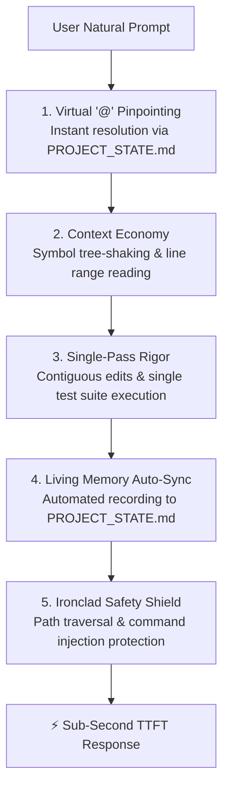

# Architecture & Security Guardrails 🛡️

## The 5-Stage Autonomous Pipeline

UAP enforces a strict execution pipeline on every agent turn:

---

## 🛡️ Ironclad Security Safeguards

### 1. Path Traversal Shield (`isSafePath`)
- Isolates all file read/write operations strictly within the workspace root.
- Rejects paths containing `../` directory traversal sequences and null bytes (`\0`).
- Forbids modification of protected `.git/` metadata (hooks, config, objects).

### 2. Command Injection Firewall (`isSafeCommand`)
- Blocks destructive system commands (`rm -rf /`, `format`, `del /s /q`, fork bombs).
- Blocks remote command execution pipes (`curl ... | bash`, `wget ... | sh`, `iex`).
- Blocks forced git operations (`git push --force`, `git reset --hard`).

### 3. Secret Redaction Shield (`redactSensitiveSecrets`)
- Scans prompt contexts and masks private API keys:
  - OpenAI / Anthropic (`sk-...`)
  - GitHub Personal Access Tokens (`ghp_...`, `gho_...`)
  - Google API Keys (`AIzaSy...`)
  - AWS Access Keys (`AKIA...`)
  - Database connection strings and RSA private keys.
